# Mandelbrot Odyssey

A real-time journey into the Mandelbrot set, computed live on your graphics card. Scroll into a spiral, fly to the famous places of the set, dive to a magnification of 10³⁰⁰, smoothly, and read the mathematics of what you see in a live atlas: Julia sets, orbits, periods, external rays, and π. Or follow the Odyssey, a story in eight chapters told by the explorer itself, let the endless dive carry you from minibrot to minibrot down to 10²⁰⁰ and beyond, listen to the orbits, and save the dive as a film. Then visit the other worlds: the Burning Ship, the Tricorn, the Multibrots and the Buddhabrot.

## Installation

You only need **Node.js 18 or newer**, which is free. Everything else installs itself on the first launch.

### 1. Install Node.js (once)

| System | Easiest way |
| --- | --- |
| **Windows** | Download the **LTS** installer from [nodejs.org](https://nodejs.org/en/download) and run it. Or, in PowerShell: `winget install OpenJS.NodeJS.LTS` |
| **macOS** | Download the **LTS** installer from [nodejs.org](https://nodejs.org/en/download). Or, with Homebrew: `brew install node` |
| **Linux** | Ubuntu 24.04 or Debian 12: `sudo apt install nodejs npm`. Fedora: `sudo dnf install nodejs`. Arch: `sudo pacman -S nodejs npm` |

To check, open a **new** terminal and run `node --version`: it should print `v18` or higher. If your Linux distribution ships an older version, follow the commands for your system on [nodejs.org/en/download](https://nodejs.org/en/download).

### 2. Get Mandelbrot Odyssey

- **Without Git:** click the green **Code** button at the top of this page, choose **Download ZIP**, then unzip it.
- **With Git:** `git clone https://github.com/yahyabmo/the-mandelbrot-set.git`

### 3. Start it

| System | What to do |
| --- | --- |
| **Windows** | Double-click `start.bat` in the folder. |
| **macOS** | Double-click `start.command` in the folder. |
| **Linux** | Open a terminal in the folder and run `./start.sh` |

The first launch installs the dependencies, which takes about a minute. The explorer then opens in your browser at <http://localhost:5191>. Later launches take a few seconds. To stop it, close the terminal window, or press <kbd>Ctrl</kbd>+<kbd>C</kbd> in it.

From a terminal, the same thing works on every system:

```bash
cd the-mandelbrot-set
npm install
npm start
```

### If something goes wrong

| Problem | Fix |
| --- | --- |
| `node` is not recognized, or "Node.js is not installed" | Install Node.js (step 1), then open a **new** terminal or window and try again. |
| "Node.js is too old" | Install the LTS version from [nodejs.org](https://nodejs.org/en/download). |
| Windows shows "Windows protected your PC" | Click **More info**, then **Run anyway**. |
| macOS says the file cannot be opened | Open **System Settings → Privacy & Security**, click **Open Anyway**, then double-click again. Or run `./start.sh` from Terminal. |
| Linux or macOS says "permission denied" | Run `chmod +x start.sh start.command` once in the folder. |
| "Port 5191 is already in use" | The explorer is probably already running: close the other window. Or start it on another port: `npm start -- --port 5192` |
| The page says WebGL2 is missing | Use a recent Chrome, Edge or Firefox, with hardware acceleration turned on in its settings. |
| The browser did not open | Open <http://localhost:5191> yourself. |

## Screenshots

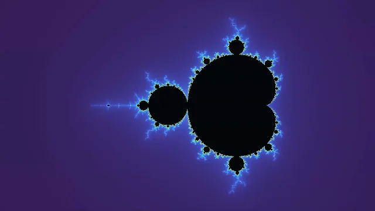

*A film made by the explorer itself, with Record a film: the dive of the original script, from the whole set to a magnification of 10¹⁸, one sharp frame at a time.*

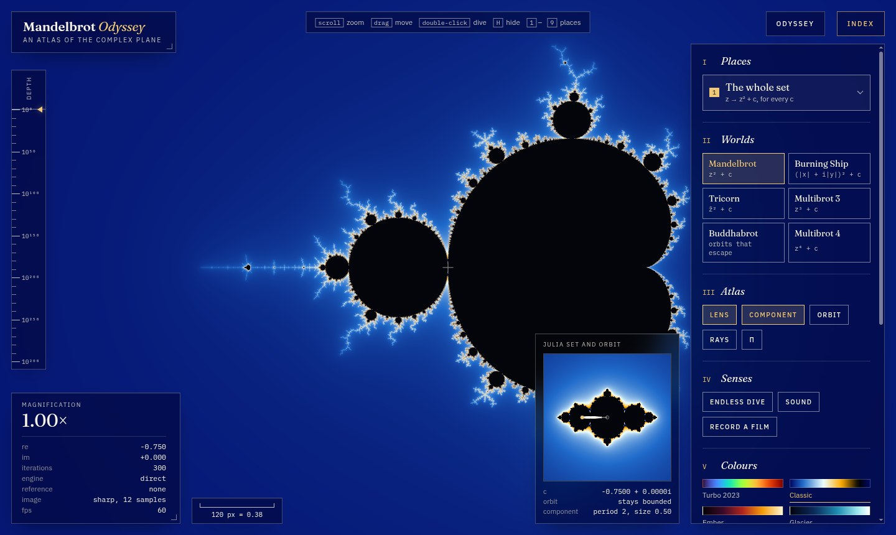

*The whole set. On the right, the index: places, atlas, palettes, detail. On the left, the depth gauge, from 10⁰ to 10³⁰⁰, and the readout of the engine at work. At the bottom, the lens: the Julia set of the point under the pointer, here c = −3/4.*

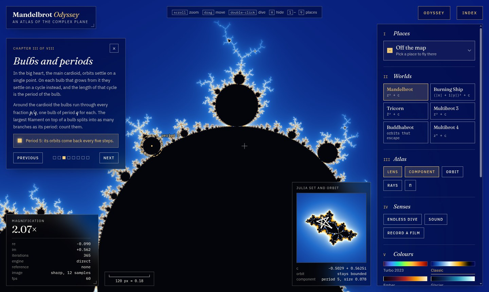

*The Odyssey, chapter III. The story frames each place in the part of the screen it leaves free, switches on the layers that explain it, and checks its task live: here the pointer has found a bulb of period 5, whose Julia set the lens shows with its five-pointed orbit.*

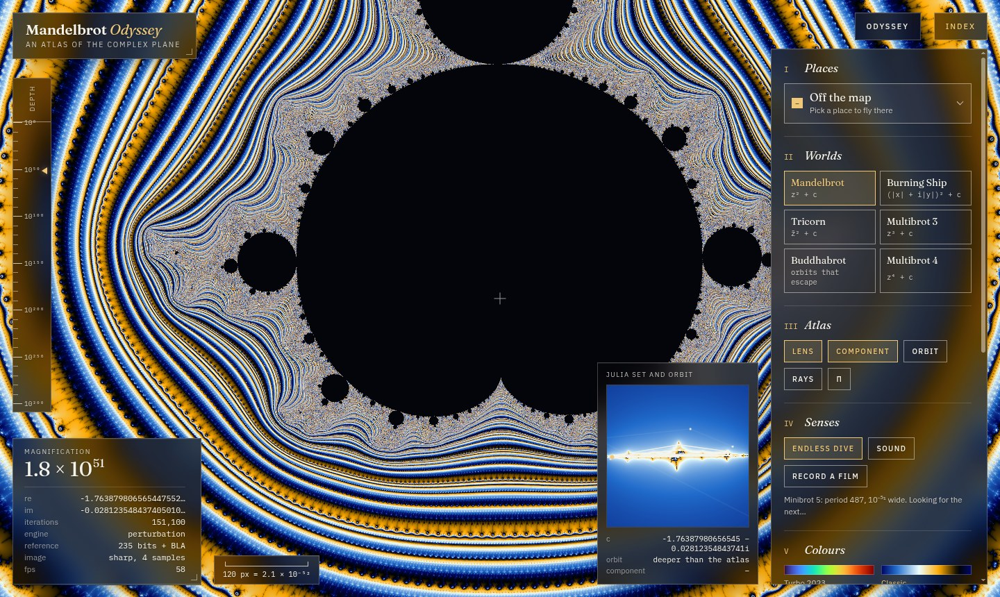

*The endless dive, resting on its fifth minibrot: a copy of the whole set, of period 487, 1.8 × 10⁵¹ times closer, drawn with 151 100 iterations per pixel. It has already found the next one.*

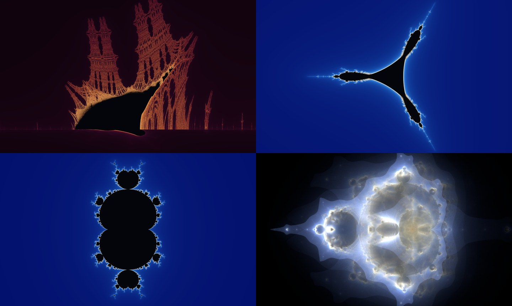

*Other worlds. The Burning Ship and its ship, the Tricorn, the Multibrot of z³, and the Buddhabrot, where random orbits that escape are counted point by point: gold for those that take up to 5000 steps, teal up to 500, blue up to 50.*

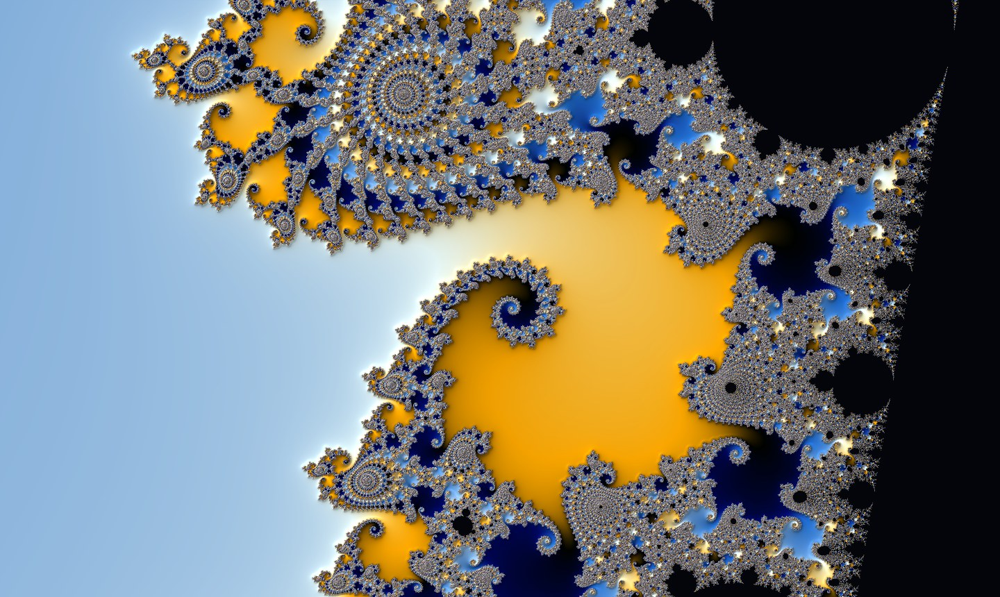

*Relief. The smooth count is read as a height map and lit from the upper left, at any depth.*

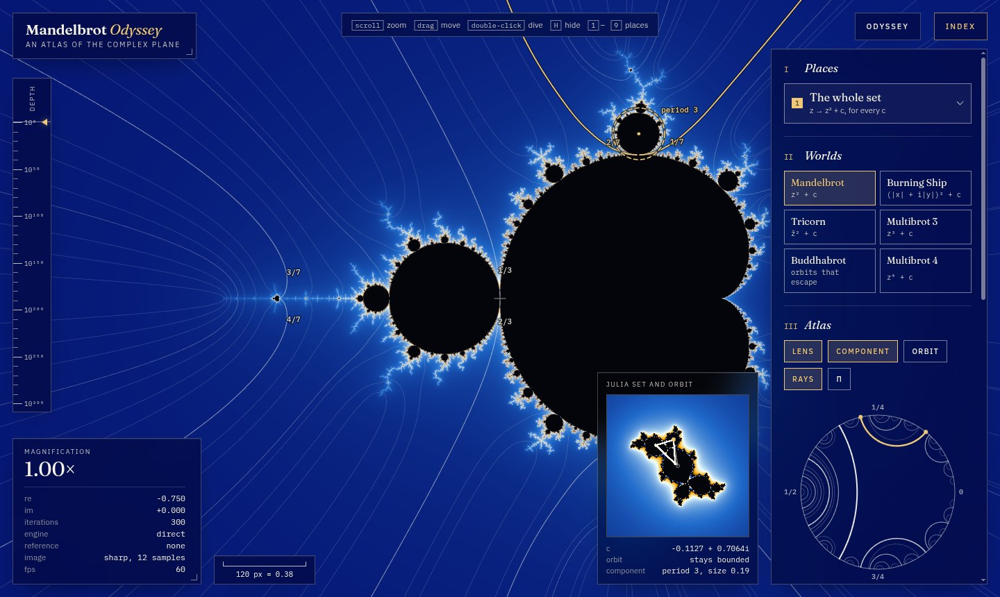

*The atlas. The pointer is in the bulb of period 3 at the top: the lens shows its Julia set, Douady's rabbit, and the orbit of 0 settling on a cycle of 3 points. The ring marks the component, and the rays 1/7 and 2/7, which land at its root, are lit, along with their chord in Lavaurs' diagram.*

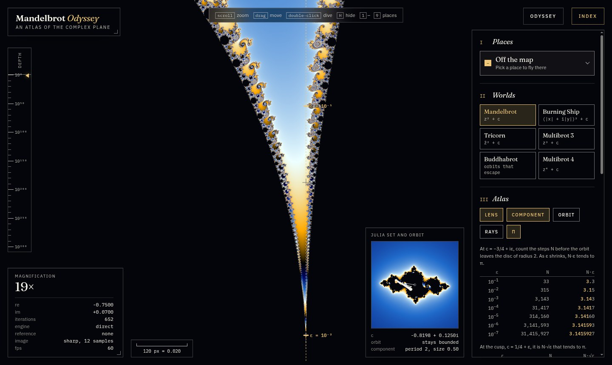

*π in the Mandelbrot set. At c = −3/4 + iε, the steps before escape times ε tend to π, digit after digit, as the table on the right shows.*

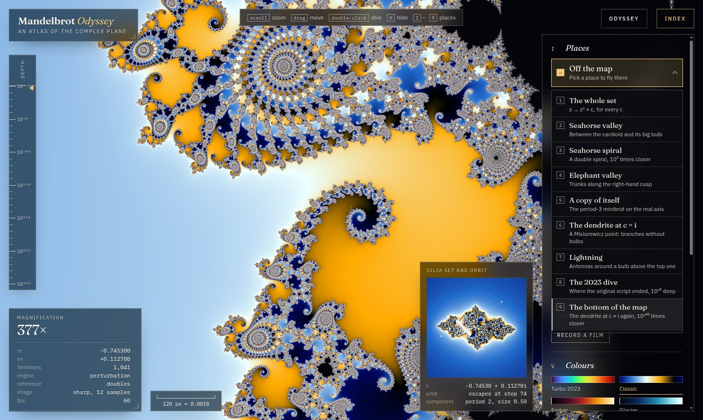

*Nine places in a drop-down list, from the whole set down to the bottom of the map. The keys 1 to 9 fly there too.*

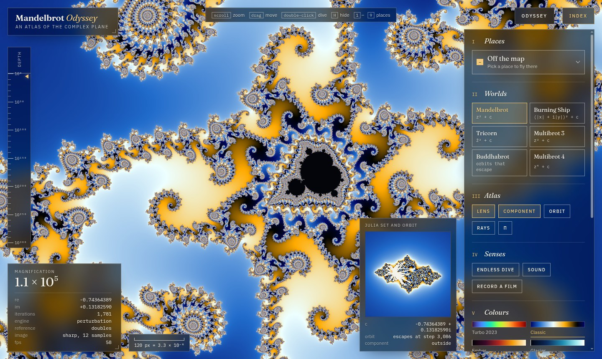

*A double spiral at a magnification of 10⁵.*

| | |
| :-: | :-: |
| 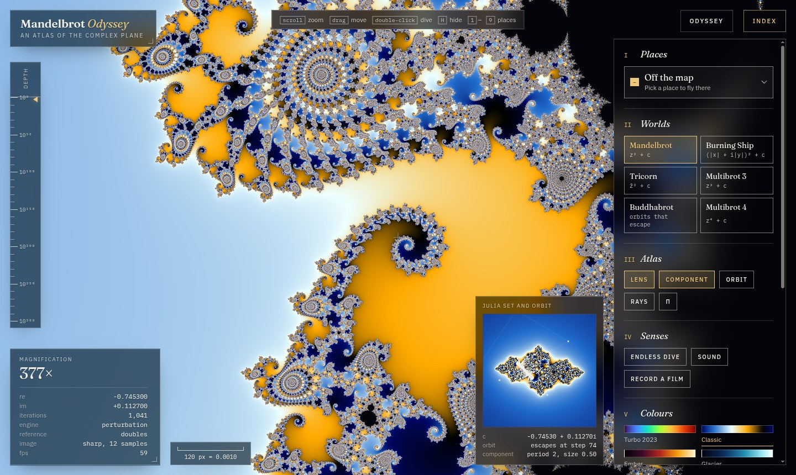 | 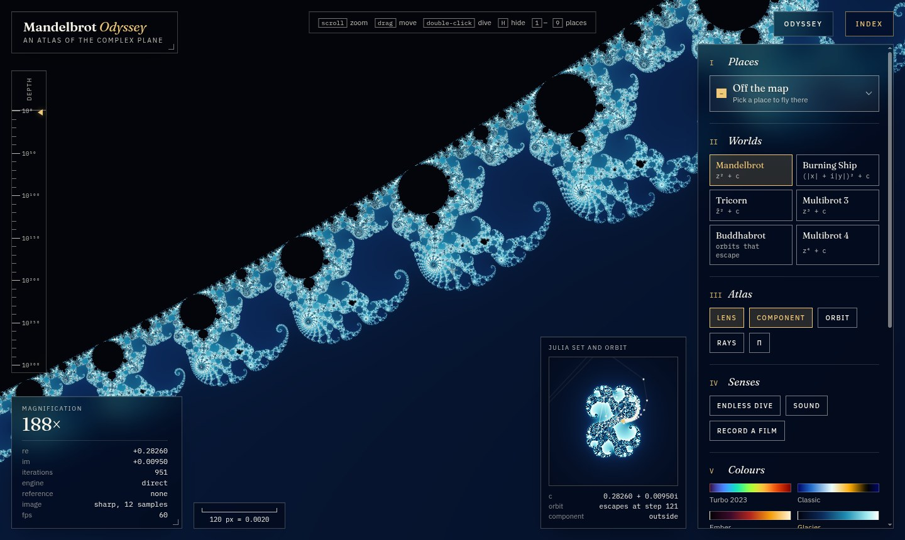 |
| *Seahorse valley* | *Elephant valley, Glacier* |
| 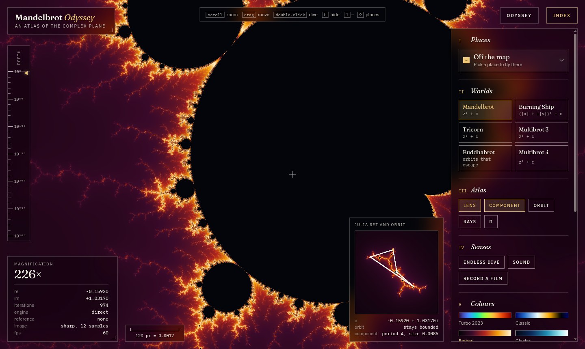 | 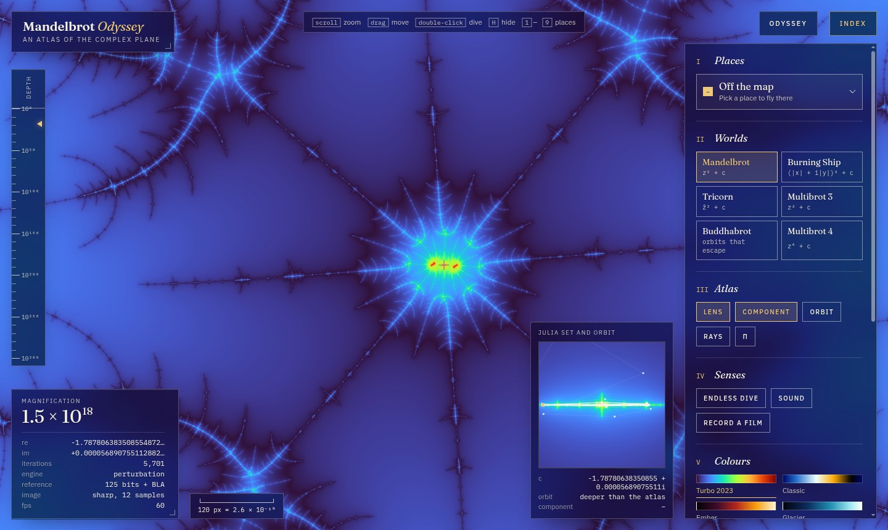 |
| *Lightning, Ember* | *The 2023 dive, 10¹⁸ deep* |

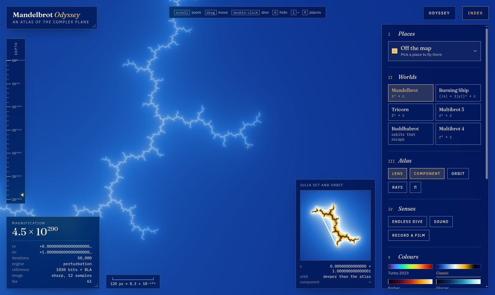

*The bottom of the map: the dendrite at c = i, 4.5 × 10²⁹⁰ times closer, computed with a reference orbit of 1030 bits. The same branches as at the top: c = i is a Misiurewicz point, where the set looks alike at every scale.*

<p align="center">
  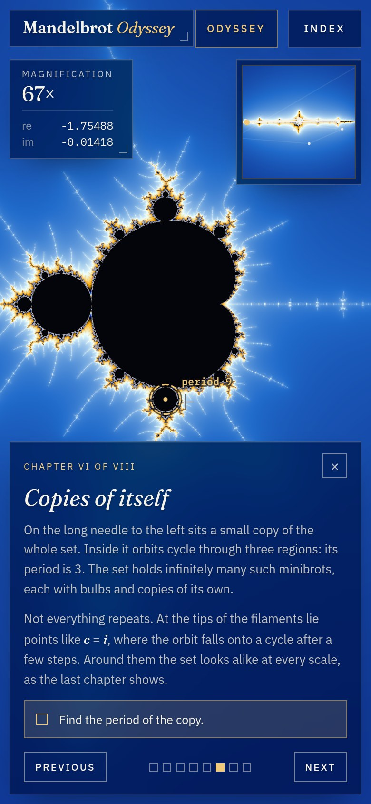
</p>

<p align="center"><em>On a phone: pinch to zoom, drag to move. The story becomes a sheet at the bottom, the lens sits at the top and reads the point under the cross.</em></p>

## What you can do

- **Zoom anywhere, as deep as 10³⁰⁰.** Scroll or pinch to zoom around the pointer, drag to move, and let go to glide. Double-click dives four times closer, <kbd>Shift</kbd> + double-click goes back. The point under the pointer stays exactly where it is all along the zoom.
- **Fly to famous places.** Seahorse valley, a double spiral, elephant valley, a minibrot copy of the whole set, the dendrite at c = i, the end of the original 2023 script at 10¹⁸, and the bottom of the map at 10²⁹⁰. A flight to a place out of sight first pulls back until it is in view, then dives, faster the deeper it goes: 10¹⁸ in about five seconds, 10²⁹⁰ in under twenty.
- **Follow the Odyssey.** Eight short chapters, from the one rule of the set to the bottom of the map at 10²⁹⁰: one rule, connected or dust, bulbs and periods, a map of rays, π in seahorse valley, copies of itself, diving, the bottom of the map. Each flies to its place and gives a small task, checked as you move. Every chapter has its own link, such as `#chapter=5`.
- **Read the atlas.** Move the pointer and the lens shows the Julia set of that point, with the orbit of 0 drawn on it: connected inside the set, dust outside. The component under the pointer is ringed, with its period and size, found by Newton's method. Turn on the external rays to see the rays of every component up to period 6, labelled by their angles, and Lavaurs' diagram, the map of how they pair: pick a chord and the explorer flies to its component. The π experiment shows why π appears in seahorse valley and at the cusp.
- **Dive for ever.** The endless dive flies from minibrot to minibrot, each about twice as deep as the last, through the embedded Julia sets between them, down to 10²⁰⁰ and beyond; at the bottom of the map it surfaces and dives again elsewhere. Press <kbd>D</kbd>.
- **Listen.** With the sound on, the orbit of the point under the pointer becomes a melody: a cycle of period p is a loop of p notes, an escaping orbit glides away. During the dive you hear the nucleus of the minibrot ahead. Press <kbd>M</kbd>.
- **Make a film.** *Record a film* renders the dive from the whole set to the current view, one sharp frame at a time, as the script of 2023 did, and saves it as an MP4 in Full HD.
- **Visit other worlds.** The Burning Ship, (|x| + i|y|)² + c, drawn upright as is the custom (click it again to fly to its ship), the Tricorn, z̄² + c, and the Multibrots z³ + c and z⁴ + c, down to a magnification of about 10⁵. And the Buddhabrot, counted live by every core of your processor.
- **Light it.** *Relief* lights the image as a landscape. Press <kbd>L</kbd>.
- **Colour it.** Seven palettes, including *Turbo 2023*, the colours of the original script: 150 steps of Turbo, up and back down. Change the density and the shift, or let the colours flow. Colours change instantly, without recomputing the image.
- **Always smooth.** While you move, the image is computed at a lower resolution that fits in the frame budget. When you stop, it sharpens, then smooths its edges with up to 12 samples per pixel.
- **Share it.** The address always holds the current view: copy the link and anyone opens the same place, with the same colours. Save the image as a PNG.

### Controls

| Input | Action |
| --- | --- |
| scroll, pinch | zoom around the pointer |
| drag | move, with inertia |
| double-click | dive ×4 (<kbd>Shift</kbd>: back ×4) |
| <kbd>←</kbd> <kbd>→</kbd> <kbd>↑</kbd> <kbd>↓</kbd> | move |
| <kbd>+</kbd> <kbd>−</kbd> | zoom on the centre |
| <kbd>1</kbd>–<kbd>9</kbd> | famous places |
| <kbd>D</kbd> | the endless dive |
| <kbd>M</kbd> | the sound of orbits |
| <kbd>L</kbd> | relief |
| <kbd>C</kbd> | flowing colours |
| <kbd>S</kbd> | save the image |
| <kbd>H</kbd> | hide the panels |
| <kbd>R</kbd> | back to the whole set |
| <kbd>Page Down</kbd> <kbd>Page Up</kbd> | next and previous chapter of the Odyssey |
| <kbd>Esc</kbd> | close the Odyssey |

## How it works

Every pixel is a complex number c. The explorer iterates z → z² + c from z = 0 and counts the steps before |z| grows past 256. Points that never escape belong to the set and stay dark. The others are coloured by a *continuous* count, n − log₂(log₂|z|²) + 4, which removes the bands of a plain count.

Graphics cards compute in 32-bit floats, which blur the image past a magnification of about 10⁴. Below that, the explorer uses **perturbation theory**, with four refinements:

1. **A reference orbit in arbitrary precision.** One orbit Zₙ is computed at the centre of the view, in fixed point with as many bits as the depth needs: 125 bits at 10¹⁸, 1030 at 10²⁹⁰. A Web Worker computes it, so the view keeps moving meanwhile, and it starts as soon as a flight heads somewhere deep, so that the orbit is often ready on arrival.
2. **Offsets in 32-bit floats.** Each pixel only follows its small offset from the reference, `dz ← 2·Z·dz + dz² + dc`. Below a pixel size of 2⁻¹⁰⁰ that offset no longer fits a float, whose smallest value is 2⁻¹²⁶: it then carries its own exponent, renormalised at every step, until it has grown large enough to be a plain float again.
3. **Rebasing.** When a pixel's orbit comes closer to zero than its offset, or the reference runs out, the pixel restarts against the beginning of the same orbit. One reference then serves the whole image, without the glitches of the plain method.
4. **Bilinear approximation.** While the offset stays small next to the reference, many steps in a row reduce to `dz → A·dz + B·dc`. The worker precomputes A and B for runs of 2, 4, 8… steps, each with the radius within which it holds, and the shader skips the longest run that does. At 10²⁹⁰ this computes 26 times fewer steps.

**Tested against exact arithmetic.** The shader's method is also written in TypeScript, line for line, in 32-bit float arithmetic that flushes tiny values to zero as GPUs do. The tests check it against iteration in exact fixed point, with over a thousand bits at the deepest, from 10¹⁷ down to 10²⁹⁰, with and without skipping. A check in the browser then compares the counts the GPU computed with that copy, pixel by pixel: they agree to within 3 × 10⁻⁵.

**Speed.** On an integrated AMD Radeon (Ryzen 7 5825U), measured in Chrome: during flights to 10⁵, 10¹⁸ and 10²⁹⁰ and back, one frame in about 3800 took longer than a screen refresh while the view was moving. A full image at 10²⁹⁰ takes 4 ms to compute with the approximation, 76 ms without. The renderer learns what one iteration costs on your GPU and sizes every frame to fit the screen refresh; while the view rests, it tries a little more work each frame to sharpen sooner.

**The atlas.** The lens draws the Julia set of c on a second, small WebGL canvas. The period of a point inside the set is that of the cycle its orbit settles on; outside, that of the step where its orbit came nearest to 0. Newton's method on z_p(c) = 0 then finds the nucleus of the component, and a classic estimate its size. External rays are traced inwards by Newton's method on z_n(c) = R^(2^(n−1−m)) e^(2πi 2^(n−1) θ), level after level, in a worker; rays that land at a parabolic root approach it slowly, so each one is followed for 300 doublings. Lavaurs' algorithm pairs the angles k / (2^p − 1) of each period without crossing the chords already drawn, and finds exactly the 1, 3, 6, 15 and 27 components of periods 2 to 6.

**The endless dive.** A box of the plane contains the nucleus of a minibrot of period p when the orbits of its four corners first surround 0 at step p. Newton's method on z_p(c) = 0, in fixed point, then places the nucleus, refined to a fraction of its own size, and the size estimate gives the copy's scale and turn. Inside the copy every minibrot is a tuned copy whose period is a multiple of p, so the dive looks just outside it, in boxes on circles a few sizes away, where embedded Julia sets hold minibrots about twice as deep with a period only a few times longer. It keeps one of those that gain the most depth for the least growth of period: periods 3, 7, 25, 77, 419, 3008 take it from 10⁻² to 10⁻¹⁰¹. Every step is computed in a worker while the camera flies to the previous one.

**Inside a minibrot.** A reference at a nucleus has an orbit one period long that ends back at 0: the pixels rebase onto its start at each period. Inside the copy, a pixel then comes back to the same offset at every return; two returns that agree to 2⁻²⁰ mark it as inside, and it stops. Outside, near the copy, an orbit makes about one turn of the period for each step the whole set would take, so a view of a deep copy needs hundreds of periods, millions of iterations, which the approximations reduce to a few hundred steps per pixel. The image in motion lowers its iterations when even the smallest preview would be late, and the image at rest batches more rows into each frame when a single row is already as slow as a whole one.

**Other worlds.** The Burning Ship, the Tricorn and the Multibrots change one line of the shader's direct loop, with a smooth count of i − log_d(log₂|z|² / log₂ B²) for a rule of power d. The Buddhabrot is not computed per pixel at all: workers draw random points of the plane, skip those of the cardioid and the big disc, follow the orbits of those that escape and add every point of them to a histogram; the page adds the workers' histograms up twice a second and scales each channel to its brightest few pixels. While the view moves, the counts already made move with it; once it rests, counting starts again on the new view.

**Relief.** The display reads the smooth counts as heights, takes their slope from the four neighbours of each pixel and lights the result, with a touch of shine. It costs no iteration, so it works at every depth.

**Depth.** The limit is a magnification of about 10³⁰⁰, where the size of a pixel stops being an ordinary double.

```
src/math/fixed.ts        numbers in fixed point on BigInt, for centres beyond double precision
src/math/mandelbrot.ts   iteration, reference orbits in doubles and in fixed point, perturbation (CPU, tested)
src/math/deep.ts         the shader's perturbation in 32-bit floats, with offsets that carry an exponent
src/math/bla.ts          the table of bilinear approximations
src/math/view.ts         view, zoom around a point, flights
src/math/atlas.ts        orbits, periods, nuclei, sizes, external rays, Lavaurs' diagram, π (tested)
src/atlas/               the lens, the drawings over the image, Lavaurs' diagram, the atlas worker
src/story/               the eight chapters of the Odyssey and their tasks (tested), the story plate
src/math/minibrot.ts     the period of a box, nuclei by Newton in fixed point, sizes (tested)
src/dive/                the plan of the endless dive (tested), its worker, the camera
src/senses/              the sound of orbits, the films
src/worlds.ts            the other worlds
src/buddha/              the Buddhabrot: its sampler (tested), its workers, its display
src/render/shaders.ts    the same iteration in GLSL, colouring, display
src/render/reference.ts  which reference to draw with, and when to ask for a new one
src/render/orbit-worker.ts  deep orbits and their tables, off the page
src/render/renderer.ts   progressive rendering, frame budget, supersampling
src/color/palettes.ts    palettes, Turbo from OpenCV
src/main.ts              navigation, index, readout, shared links
legacy/mandelbrot.py     the original 2023 script
```

## Development

```bash
npm install
npm run dev      # http://localhost:5191
npm test
npm run build    # static site in dist/
```

The site runs locally. `.github/workflows/ci.yml` runs the tests and the build on every push.

## Roadmap

- [x] **Phase 1.** Real-time explorer: smooth navigation, perturbation to 10¹², palettes, places, shared links, image export.
- [x] **Phase 2.** Deep zoom to 10³⁰⁰: arbitrary-precision reference in a worker, offsets that carry their own exponent, bilinear approximation, the 2023 dive to 10¹⁸.
- [x] **Phase 3.** Atlas: Julia sets and orbits under the pointer, periods and sizes of components, external rays, Lavaurs' diagram, π in seahorse valley.
- [x] **Phase 4.** Odyssey: an interactive story in eight chapters, driven by the live explorer, with live tasks.
- [x] **Phase 5.** Senses: the endless dive through embedded Julia sets, the inside of minibrots detected, orbits as sound, films in MP4.
- [x] **Phase 6.** The Buddhabrot, relief lighting, the Burning Ship, the Tricorn and the Multibrots.

## Credits

- The Turbo colormap is by Google (Apache-2.0), read from OpenCV's `COLORMAP_TURBO`.
- Films are written to MP4 with [Mediabunny](https://mediabunny.dev) (MPL-2.0), over the WebCodecs of the browser.
- Perturbation for deep zoom was introduced by K. I. Martin. Rebasing and the bilinear approximation were introduced by Zhuoran on Fractal Forums. The continuous count follows Inigo Quilez's article on smooth iteration.
- π in seahorse valley was found by Dave Boll in 1991. Lavaurs' diagram and its algorithm are due to Pierre Lavaurs (1986). Tracing external rays by Newton's method follows Tomoki Kawahira's algorithm.
- The original 2023 script, kept in [`legacy/`](legacy/), rendered this zoom one image at a time with 80-bit arithmetic.
